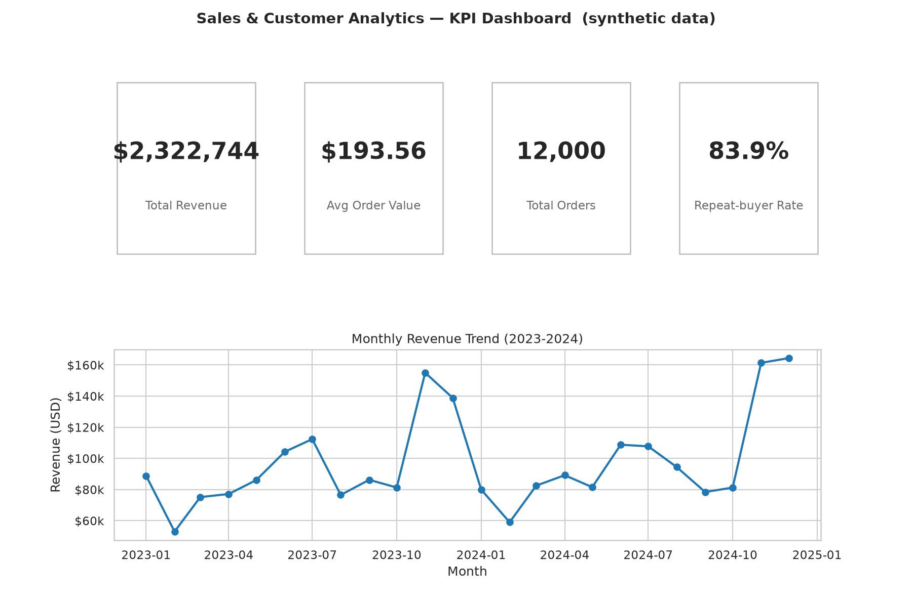
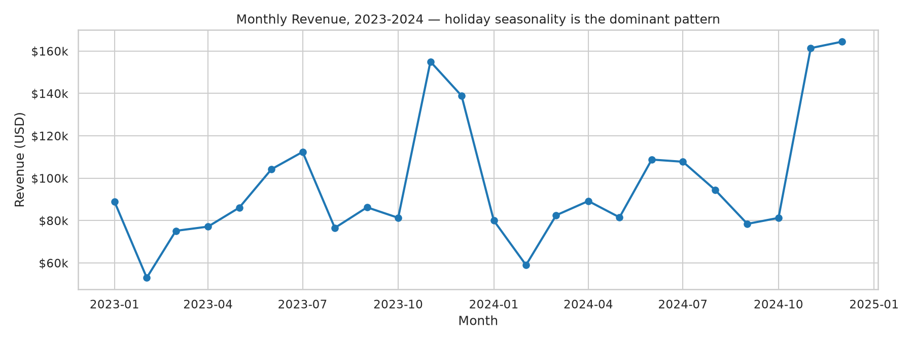
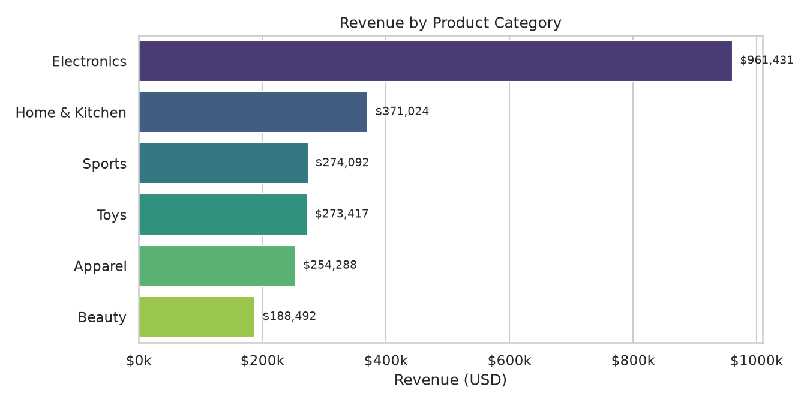
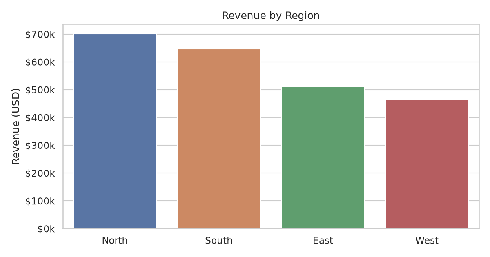
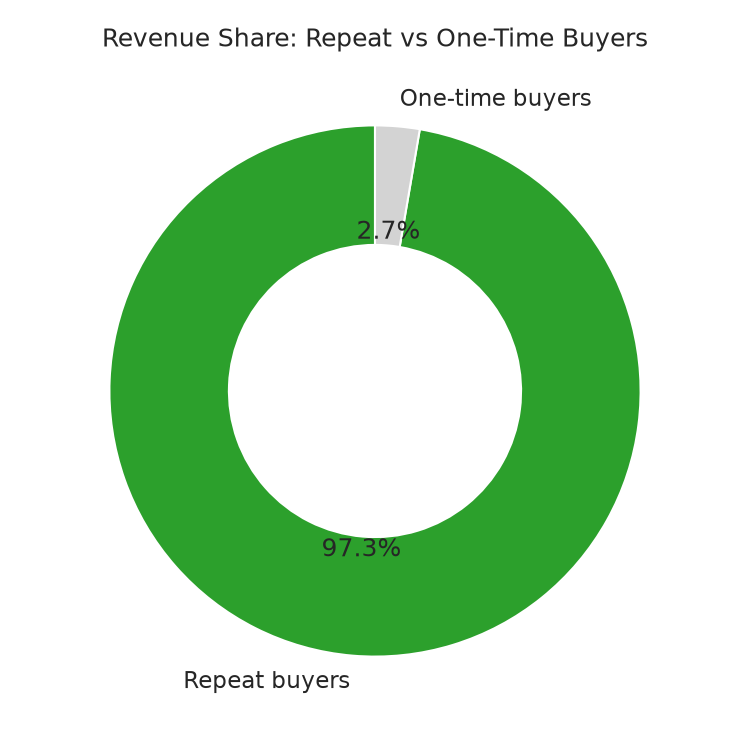
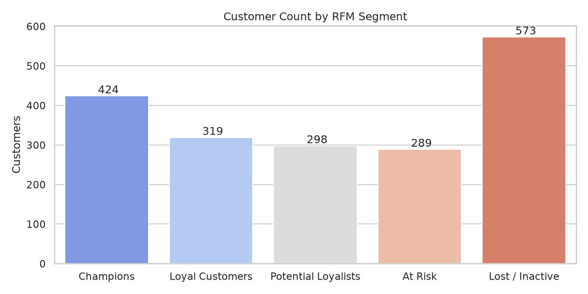

# Sales & Customer Analytics Dashboard

An end-to-end analytics project on **synthetic retail data**: SQL KPI queries,
Python EDA with RFM customer segmentation, and a KPI dashboard overview —
the kind of analysis a data analyst delivers to understand revenue trends,
customer behavior, and product performance.

> **Portfolio project — synthetic data.** All tables were generated by
> `src/generate_data.py` (seeded, `random_state=42`). No real company,
> customer, or transaction is represented.

Author: **Sreya Peddu** — Senior Data Analyst
([github.com/sreyapeddu-analytics](https://github.com/sreyapeddu-analytics) ·
[linkedin.com/in/sreyapeddu](https://www.linkedin.com/in/sreyapeddu))

## Business Problem

A retail business needs to answer, every month: *Where is revenue coming from,
who is buying, and what should we do next?* This project builds the full
analyst workflow for that question — from raw order tables to KPI definitions,
segment-level customer insight, and an executive-ready dashboard view.

## Dataset

Synthetic, generated in-repo (`src/generate_data.py`, seed 42):

| Table | Rows | Description |
|---|---|---|
| `orders.csv` | 12,000 | Orders from 2023-01-01 to 2024-12-31: date, customer, product, quantity, unit price, discount, line total, channel |
| `customers.csv` | 2,500 | Customer id, name, region, city, signup date |
| `products.csv` | 60 | Product id, name, category (6 categories), unit price |

Realistic patterns baked in: November/December holiday spike, a summer bump,
slow February, a loyalty-skewed customer base (a core of repeat buyers drives
most orders), and Online as the largest channel. See `data/README.md` for the
full schema.

## Objectives

1. Define and compute core retail KPIs: total revenue, average order value
   (AOV), repeat-buyer rate, and repeat-buyer revenue share.
2. Break revenue down by month, product category, region, and sales channel.
3. Segment customers with RFM (Recency / Frequency / Monetary) scoring to
   surface Champions, At-Risk, and Lost customers.
4. Express the same KPIs as SQLite queries so results are independently
   verifiable in SQL.
5. Summarize everything in a KPI dashboard overview.

## Data Cleaning

`src/data_cleaning.py` (`load_and_clean`):

- Parses dates, enforces dtypes (int quantities, float amounts).
- Drops duplicate `order_id`s — **0 found**.
- Validates key integrity (no null keys), non-negative amounts/quantities, and
  recomputes `line_total = unit_price × quantity × (1 − discount)` — max drift
  **$0.00**, so the generated data is internally consistent.
- Enriches orders with `order_month` / `order_year` for time-series analysis.

## SQL Analysis

`sql/analysis_queries.sql` contains 6 SQLite-compatible queries, executed
independently in the notebook against the CSVs loaded into an in-memory
database:

1. Monthly revenue by region
2. Top 10 products by revenue
3. Repeat vs one-time customer revenue share
4. Year-over-year monthly revenue growth (2024 vs 2023)
5. Average order value by category
6. Channel performance (bonus)

The SQL results match the Python KPI functions exactly (e.g., repeat-buyer
revenue share = 97.3% in both).

## EDA

Exploratory analysis lives in `notebooks/analysis.ipynb` (executed — all
outputs committed):

- **Revenue trend:** monthly revenue line chart; holiday seasonality dominates.
- **Category mix:** Electronics is the runaway leader on revenue despite fewer,
  higher-priced units; Beauty is the long tail of small tickets.
- **Geography & channel:** North region leads; Online > In-Store > Mobile App.
- **Customer behavior:** repeat-buyer analysis plus full RFM segmentation with
  per-segment lifetime spend.
- Reusable KPI logic is factored into `src/analysis.py`
  (`total_revenue`, `average_order_value`, `monthly_revenue`,
  `revenue_by_region`, `revenue_by_category`, `top_products`,
  `repeat_customer_stats`, `yoy_monthly_growth`, `rfm_segmentation`, …).

## Key Insights

(All values computed in the executed notebook — no hand-typed numbers.)

1. Two-year revenue totals **$2,322,744.42** across **12,000 orders**
   (AOV **$193.56**).
2. Holiday seasonality dominates: December revenue grew **+18.4% YoY**,
   November **+4.1% YoY**.
3. **Electronics** is the top category at **$961,431** (**41.4%** of revenue).
4. The **North** region leads with **$700,980** (**30.2%** of revenue).
5. **1,597 repeat buyers** (83.9% of purchasing customers) generate **97.3%**
   of revenue — retention is the growth lever.
6. RFM segmentation flags **289 At-Risk customers** for win-back campaigns.

## Dashboard

KPI definitions and a description of each visual live in
[`dashboard/README.md`](dashboard/README.md). Overview:













## Results & Metrics

| Metric | Value |
|---|---|
| Total revenue (2023–2024) | $2,322,744.42 |
| Total orders | 12,000 |
| Average order value | $193.56 |
| Purchasing customers | 1,903 of 2,500 |
| Repeat-buyer rate | 83.9% (1,597 buyers) |
| Repeat-buyer revenue share | 97.3% |
| Top category | Electronics — $961,431 (41.4%) |
| Top region | North — $700,980 (30.2%) |
| Top channel | Online — $1,050,865 (45.2%) |
| December YoY revenue growth | +18.4% |
| At-Risk customers (RFM) | 289 |

## Technologies Used

- **Python** — Pandas, NumPy (data wrangling, KPI functions)
- **Matplotlib / Seaborn** — charts and the KPI dashboard figure
- **SQL (SQLite)** — 6 KPI queries in `sql/analysis_queries.sql`
- **Jupyter** — executed analysis notebook with narrative
- **Git** — version control

## How to Run

```bash
# 1. Install dependencies
pip install -r requirements.txt

# 2. (Re)generate the synthetic dataset — seeded, reproducible
python src/generate_data.py

# 3. Run the KPI functions / cleaning check
python src/data_cleaning.py

# 4. Open the executed analysis
jupyter notebook notebooks/analysis.ipynb
```

To re-execute the notebook end to end:

```bash
jupyter nbconvert --to notebook --execute notebooks/analysis.ipynb \
  --output notebooks/analysis.ipynb --allow-errors
```

## Resume-Ready Description

> Built an end-to-end sales analytics project on synthetic retail data
> (12K orders, 2023–2024): SQL KPI queries, Python EDA with RFM customer
> segmentation, and a KPI dashboard — surfacing holiday seasonality,
> category/region performance, and a 97% repeat-buyer revenue concentration.

## Project Structure

```
sales-customer-analytics/
├── README.md
├── data/
│   ├── README.md          # schema + synthetic-data note
│   ├── orders.csv         # generated (12,000 rows)
│   ├── customers.csv      # generated (2,500 rows)
│   └── products.csv       # generated (60 rows)
├── notebooks/
│   └── analysis.ipynb     # executed: narrative + code + outputs
├── src/
│   ├── generate_data.py   # seeded synthetic data generator (random_state=42)
│   ├── data_cleaning.py   # load, validate, enrich
│   └── analysis.py        # reusable KPI functions
├── sql/
│   └── analysis_queries.sql  # 6 SQLite-compatible KPI queries
├── dashboard/
│   └── README.md          # KPI definitions + visual descriptions
├── images/                # charts (150 dpi PNG)
├── requirements.txt
└── .gitignore
```
